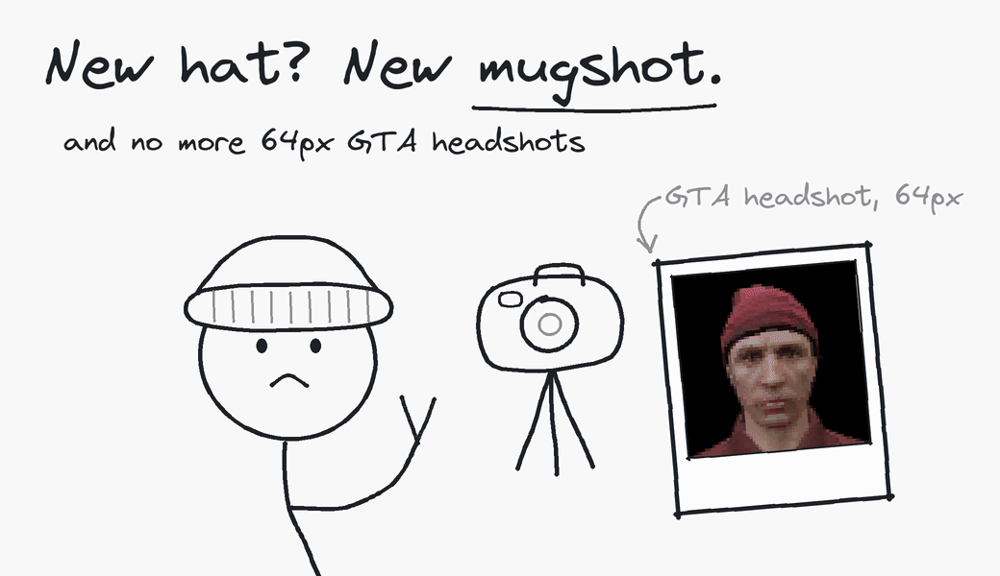
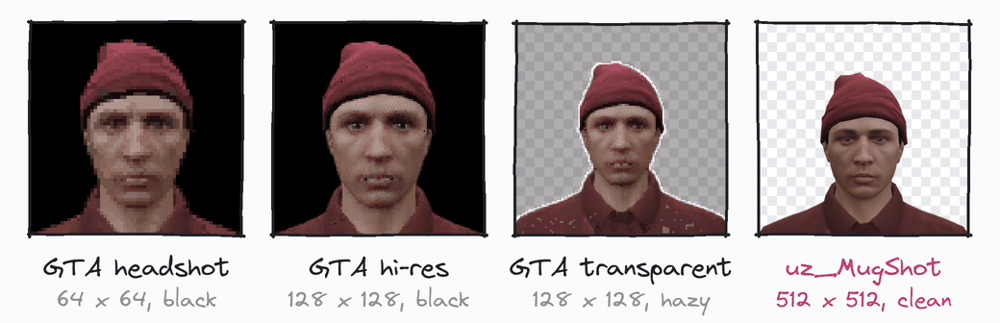
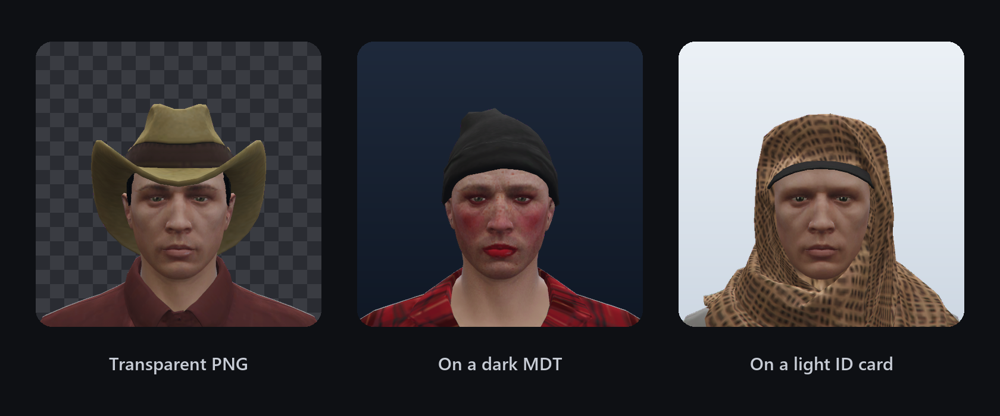

<div align="center">

<picture>
  <source media="(prefers-color-scheme: dark)" srcset=".github/assets/mugshot-dark.gif">
  
</picture>

# uz_MugShot

Automatic transparent player mugshots for FiveM.<br/>
Taken in a chroma studio whenever a player's look changes, served to any script with one export.

[](https://github.com/uz-scripts/uz_MugShot/releases/latest)
[](LICENSE)

[](https://discord.uz-scripts.com)

[Docs](https://uz-scripts.com/docs/free/uz-mugshot) · [Download](https://github.com/uz-scripts/uz_MugShot/releases/latest) · [Report a bug](https://github.com/uz-scripts/uz_MugShot/issues/new/choose) · [Discord](https://discord.uz-scripts.com)

</div>

## Features

- **Hands-free.** A photo is taken when the player leaves the barber, the clothing menu or character creation. Works with any appearance script, without adding code to it.
- **Studio quality.** 512×512, the same camera and lights on every photo, real transparency from a server-side chroma key.
- **Stays out of the way.** Captures wait until no menu, camera, fade or cutscene owns the screen. The player sees a curtain for about a second.
- **Stored per character.** Look a photo up by citizenid, server ID or ped, also for offline characters. No database.
- **Drop-in for MugShotBase64.** Existing `exports['MugShotBase64']` calls keep working.
- **Qbox, QBCore and ESX**, auto-detected.

## Why not GTA's headshot?

Most scripts get their photo from GTA's `RegisterPedheadshot`, directly or through [MugShotBase64](https://github.com/BaziForYou/MugShotBase64). This resource was built to replace that.

<picture>
  <source media="(prefers-color-scheme: dark)" srcset=".github/assets/compare-dark.png">
  
</picture>

<sub>The same character in game: `RegisterPedheadshot`, `RegisterPedheadshot_3` (hi-res) and `RegisterPedheadshotTransparent` as they come out of `nui-img`, next to uz_MugShot.</sub>

| | Native headshot / MugShotBase64 | uz_MugShot |
|---|---|---|
| Size | 64×64 from `RegisterPedheadshot`, the one MugShotBase64 uses. The hi-res and transparent variants give 128×128 | 512×512 |
| Background | Black. `RegisterPedheadshotTransparent` fails often ([citizenfx/fivem#2611](https://github.com/citizenfx/fivem/issues/2611)), and when it works it leaves a dark haze and a white outline. MugShotBase64's transparent mode loads a body-pix model in NUI on every call and cuts a hard on/off mask | Chroma studio, keyed on the server with soft edges |
| Framing | A tight head crop you cannot change | Camera, lights and framing set in `config.lua`, the same on every photo |
| When | Taken again on every call, waiting up to 2 seconds each time | Taken once when the look changes, served from disk after that |
| Whose | Only peds that exist on the calling client | Any character by citizenid, offline too, from client or server |
| Storage | None. Each script saves its own copy, which goes stale | One photo per character, `uz_mugshot:captured` fires when it changes |

## Install

You need a recent FiveM artifact, [screenshot-basic](https://github.com/citizenfx/screenshot-basic), `yarn` (ships with the server artifacts) and one of `qbx_core`, `qb-core` or `es_extended`.

1. Download `uz_MugShot.zip` from the [latest release](https://github.com/uz-scripts/uz_MugShot/releases/latest) and put the `uz_MugShot` folder in your resources.
2. Add it to `server.cfg` after your framework, and give admins the retake command:
   ```
   ensure screenshot-basic
   ensure yarn
   ensure uz_MugShot

   add_ace group.admin command.remugshot allow
   ```
3. Start the server. Photos save to `shots/{cid}/` inside the resource folder.

> [!IMPORTANT]
> The folder must be named exactly `uz_MugShot` (case-sensitive on Linux), because other scripts call it as `exports['uz_MugShot']`. GitHub's "Download ZIP" button unpacks as `uz_MugShot-main`; rename it. Under any other name the resource prints an error and stops.

Upgrading from an older build that saved `shots/{cid}_mugshot.png`? Nothing to do: each old photo (and its `.fp`) moves into the new folder the first time it is read. The fingerprint now also covers face features and makeup opacity, so every character is recaptured once on their next login or appearance change.

## Usage

| Export | Side | Returns |
|---|---|---|
| `GetPhotoDataURI(id)` | server, client | PNG data URI, or `nil` if there is no photo |
| `HasPhoto(id)` | server | `true` / `false` |
| `GetPhotoByCitizenId(citizenid)` | client | PNG data URI or `nil` |
| `CaptureAndReturn(id)` | server | a freshly taken data URI, or `nil` (blocks up to 15 s) |
| `ForceRecapture(id)` | server | `true` if the capture was sent to the player |
| `TriggerInitialCapture(source)` | server | nothing, see [Login check](#login-check) |
| `GetMugShotBase64(ped, transparent)` | client | MugShotBase64 compat, see [below](#already-using-mugshotbase64) |

### Show a mugshot on your MDT

```lua
local uri = exports['uz_MugShot']:GetPhotoDataURI(playerId)
```

`playerId` can be whichever form you have on hand:

| Form | Where you'd have it |
|---|---|
| `citizenid` string (Qbox / QBCore) or `identifier` (ESX) | Server code with a player record loaded |
| server source (number) | Server event handlers (`source` variable) |
| ped entity (number) | Client code (`PlayerPedId()`, `GetPlayerPed(i)`) |

Whatever you pass, it resolves to the same stored photo: a base64 `data:image/png;...` string you can put straight into an `` in your NUI. It returns `nil` if the player has no saved mugshot yet, so show your placeholder in that case.

```lua
if exports['uz_MugShot']:HasPhoto(citizenid) then
    ...
end
```

### Look up by citizenid (multichar / offline scripts)

When you only have the citizenid (no source, no ped), call the client-side export. Useful for character selectors where the player hasn't spawned yet:

```lua
local uri = exports['uz_MugShot']:GetPhotoByCitizenId(citizenid)
```

### Put a photo on an ID card item

Call this from your ID card script when the item is created. It triggers a capture, waits for the image to process, and hands it back:

```lua
local uri = exports['uz_MugShot']:CaptureAndReturn(citizenid)
if uri then
    item.metadata.image = uri
end
```

It blocks for up to 15 seconds and returns `nil` if the player is offline or the capture times out.

### Force a retake

From the server (admin action, an appearance change your script noticed, anything):

```lua
exports['uz_MugShot']:ForceRecapture(citizenid)
```

In game, as an admin:

```
/remugshot
/remugshot 5
```

No ID means yourself. From the server console the ID is required (`remugshot 5`).

## The photo



One photo per character, framed wide enough for ID cards and MDT profiles. If you want a closer crop, zoom in your UI, the source is 512×512 so you have room.

Every photo uses the same framing and lighting, so mugshots look consistent across the server. The defaults are already dialed in. To change them, edit `Config.Variants.mugshot` (fov, distance, height, `roll`, `facialMood`) and `Config.Lighting` in `config.lua`.

## How auto capture works

When the player finishes character creation, leaves the barber, or changes clothes, the script captures in the background. It works with any clothing, barber or skin script (illenium-appearance, fivem-appearance, qb-clothing, esx_skin, custom ones) **without adding code to that script**.

<details>
<summary><b>Fingerprint watch</b>: only changes the camera can see trigger a photo</summary>

<br/>

The client hashes the mugshot-visible ped state: model, heritage blend, face features, skin, hair, makeup and its opacity, head and upper-body components, hats and glasses. When that hash differs from the one stored next to the current photo (`shots/{cid}/mugshot.fp`), the client asks the server to compare. The server re-checks against the stored fingerprint and only then dispatches a capture. Pants and shoe changes are invisible to the mugshot, so the player never sees a flash.

A look that changed while a menu was open is checked the moment the menu closes, so the short curtain overlaps the menu's own exit. A change made outside any menu (an outfit command, a skin applied by a script) is checked once it has held still for `settleMs`, polled every `intervalMs`.

```lua
Config.FingerprintWatch = {
    enabled = true,
    intervalMs = 1000,
    settleMs = 4000,   -- changes outside a menu must hold this long
    retryMs = 15000,   -- resend a check the server did not answer
}
```

The stored fingerprint survives resource restarts and relogs, so a player whose mugshot is already up to date is not recaptured when they log in the next day. Delete the `.fp` file (or the PNG) to force a recapture on the next check.

**Not detected:** tattoo and other decoration changes. GTA has no getter for ped decorations, so they cannot be part of the hash. Use `/remugshot` or `ForceRecapture` after a tattoo-only change.

</details>

<details>
<summary><b>Plain gameplay guard</b>: a capture never takes over someone else's screen</summary>

<br/>

A capture never starts while another resource owns the screen: NUI focus (menus, phones, inventories), another resource's camera, a screen fade, the pause menu, a character switch, a cutscene, the loading screen or spectator mode. Some scripts save on every outfit pick while their menu is still open (illenium-appearance does); those captures wait until the menu closes instead of taking over its camera. This applies to every capture, including `/remugshot`, `ForceRecapture` and `CaptureAndReturn`. A capture that cannot start within `timeoutMs` is dropped and the watch tries again later.

```lua
Config.CaptureGuard = {
    settleMs = 0,       -- extra quiet period after the screen is free
    timeoutMs = 60000,
}
```

Force paths (`/remugshot`, `ForceRecapture`, `CaptureAndReturn`) skip the fingerprint comparison and always capture. They still wait for plain gameplay, and they overwrite both the PNG and the fingerprint sidecar.

</details>

<details>
<summary><b>Trigger events</b>: optional, for an instant check on save</summary>

<br/>

A listed save event runs the check right away, even for changes made outside a menu, and even when the hash looks unchanged, so the server re-reads the stored fingerprint.

```lua
Config.NaturalTriggers        = {}                                          -- client-side
Config.ServerNaturalTriggers  = {                                           -- server-side, relayed
    'illenium-appearance:server:saveAppearance',
    'fivem-appearance:server:saveAppearance',
    'qb-clothing:saveSkin',
    'esx_skin:save',
}
```

Deliberately NOT listening to `playerSpawned`. Spawn is not an appearance-change event. The photo persists on disk and is re-used until the look really changes.

</details>

### Login check

The fingerprint watch also covers login: a character with no photo, or whose look changed while offline (admin DB edit, skin swap), is captured a few seconds after reaching plain gameplay (`settleMs`, so a skin that loads late is not photographed half-applied). The guard keeps it away from character selection and spawn selector cameras, player switches and fades. A new character on the same session is tracked separately, even if it looks identical to the previous one.

**uz_Multicharacter also calls an explicit trigger**, which skips the watch's settle time. Other multichar or spawn scripts can do the same from their spawn completion hook. This is optional:

```lua
exports['uz_MugShot']:TriggerInitialCapture(source)

-- Or via event:
TriggerEvent('uz_mugshot:initialCapture', source)
```

Both forms run the same fingerprint comparison: no photo yet means a capture, a matching photo is skipped silently, and a look that changed while offline is captured. Duplicate calls for the same character in one session are ignored. Turn the explicit trigger off with `Config.InitialCapture.enabled = false`.

### Live updates when a photo changes

This matters if your script displays photos in a UI that can already be open when a new photo is taken. Classic case: an officer is viewing a suspect's MDT profile while the suspect visits the barber, the mugshot is retaken in the background, and the open NUI should refresh on its own.

`uz_mugshot:captured` (server event, payload `citizenid, variant`) fires after the photo is saved to disk and written to the cache, so any `GetPhotoDataURI` call right after the event returns the fresh image:

```lua
-- server side of your resource
AddEventHandler('uz_mugshot:captured', function(cid, variant)
    local uri = exports['uz_MugShot']:GetPhotoDataURI(cid)
    TriggerClientEvent('my_mdt:photoUpdated', -1, cid, uri)
end)
```

```js
// NUI side
window.addEventListener('message', (e) => {
    if (e.data.action === 'photoUpdated' && e.data.cid === currentCitizen) {
        document.getElementById('mugshot').src = e.data.uri
    }
})
```

If your UI fetches the photo every time it opens, you don't need any of this. `GetPhotoDataURI` always returns the latest saved version.

Items with photos baked into their metadata (ID cards, driver licenses) deliberately stay frozen, just like a real ID card. Issue a new item for a new photo.

## Already using MugShotBase64?

Drag and drop. Remove `MugShotBase64` from your resources, put `uz_MugShot` in its place. The `fxmanifest` declares `provide 'MugShotBase64'` and ships a `GetMugShotBase64(ped, transparent)` client export, so every existing `exports['MugShotBase64']:GetMugShotBase64(...)` call keeps resolving. No consumer code changes.

To migrate to the native API later:

```lua
-- Old
local b64 = exports['MugShotBase64']:GetMugShotBase64(ped, true)

-- New (full 512×512 photo, nil when there is none)
local b64 = exports['uz_MugShot']:GetPhotoDataURI(ped)
```

**What the compat export returns:**

- Players with a stored photo get it scaled to `Config.Compat.size`, 128×128 by default. That is twice the width of GTA's 64×64 headshot and keeps the string around 20 KB for scripts that save it in item metadata (the full photo is 160-270 KB, the original's headshot about 5 KB). Set it to `64` to match the original's size, or `512` for the full photo.
- NPCs, preview peds and players not captured yet get GTA's native headshot, like the original. If that fails too, an empty string. Never `nil`.
- The `transparent` flag is ignored. Stored photos are always transparent, the native fallback never is.

## Troubleshooting

<details>
<summary><code>Access denied for command remugshot</code></summary>

<br/>

The command is ACE-restricted. Add `add_ace group.admin command.remugshot allow` to your `server.cfg`, and make sure your own identifier is in `group.admin`. From the server console it runs without ACE (`RegisterCommand(..., true)` only gates players), but needs a target ID.

</details>

<details>
<summary>Photo has a solid black background instead of transparent</summary>

<br/>

The chroma wall isn't being read as magenta. Most common cause: a timecycle modifier from a graphics mod or another script darkening the whole frame, so the walls no longer read as `(255, 0, 255)`.

</details>

<details>
<summary>Thin magenta outline on edges, or neon-pink clothing turning see-through</summary>

<br/>

The key treats anything closer than `Config.ChromaProcessing.threshold` to pure magenta as background, and the next `feather * 20` units as a soft edge. Raising `feather` cleans edges but starts eating colours close to magenta (neon pink `255,10,170` already sits inside the default edge band); lowering it does the reverse. The outermost opaque pixels, which the resize blends with the backdrop, are cleaned separately: each is matched against the interior pixels next to it and turned into a soft edge, or only loses the magenta it has beyond its neighbours (`edgeResidual`, 0 disables it). Strands one or two pixels wide have no interior neighbour and are left as they are. With `Config.Debug = true` the unkeyed screenshot is kept as `shots/{cid}/mugshot.raw.png` so you can tune against real captures.

</details>

<details>
<summary><code>GetPhotoDataURI</code> returns <code>nil</code> or empty</summary>

<br/>

The ped is an NPC (no citizenid), the player has no stored photo yet, or the player is offline with no saved photo. Show your default placeholder in this case. Requests are also rate limited per player (`Config.RequestLimit`); a client that floods requests gets empty results until its budget refills.

</details>

<details>
<summary>Photo not updating after a clothing change</summary>

<br/>

With `Config.Debug = true` the client prints why a capture waited, for example `skipped, player not in plain gameplay: nui_focus`. A resource that keeps NUI focus or its own camera active all the time blocks every capture; fix that resource or close its UI. Changes made outside a menu are only checked after they have held still for `Config.FingerprintWatch.settleMs`.

</details>

<details>
<summary>No capture on login, barber or clothing</summary>

<br/>

If no framework is found 10 seconds after start, the server console prints a `no framework detected` warning. A framework that starts after `uz_MugShot` is picked up automatically; if the warning stays, check that `qbx_core` / `qb-core` / `es_extended` is running or set `Config.Framework` explicitly.

</details>

<details>
<summary>Weather or time looks wrong right after a photo</summary>

<br/>

The studio holds noon and `EXTRASUNNY` during the shot. `Renewed-Weathersync` is paused through `LocalPlayer.state.syncWeather` / `playerWeather`, and `qb-weathersync` / `qbx_weathersync` through their `DisableSync` / `EnableSync` events. A sync that was already off (for example inside a qb-apartments interior) is left off. Afterwards the previous clock and weather are put back and the paused sync takes over again. A clock override that existed before the shot is restored; one that did not is removed. Without one of those weathersyncs the weather persist flag is cleared too, so natural weather keeps cycling.

</details>

Still stuck? Ask on [Discord](https://discord.uz-scripts.com) or [open an issue](https://github.com/uz-scripts/uz_MugShot/issues/new/choose).

## Contributing

Bug reports, fixes and support for more frameworks or weathersync scripts are welcome. Read [CONTRIBUTING.md](CONTRIBUTING.md) before opening a pull request, and report security problems privately as described in [SECURITY.md](SECURITY.md). Everyone taking part is expected to follow the [Code of Conduct](CODE_OF_CONDUCT.md).

## Our Other Work

UZ Scripts specializes in high-performance, developer-friendly scripts for the FiveM ecosystem. Explore our full collection: [uz-scripts.com/scripts](https://uz-scripts.com/scripts)

Full documentation: [uz-scripts.com/docs/free/uz-mugshot](https://uz-scripts.com/docs/free/uz-mugshot) · Discord: [discord.uz-scripts.com](https://discord.uz-scripts.com)

## License

Apache License 2.0. See [LICENSE](LICENSE) for details.
